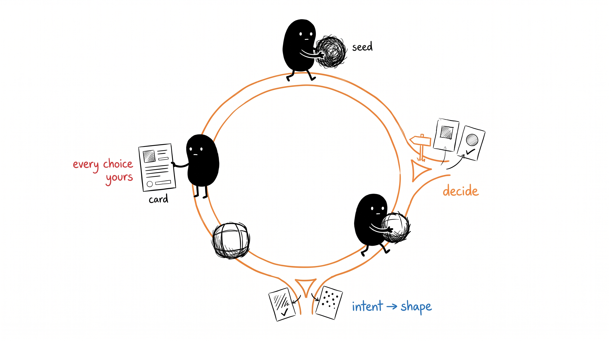
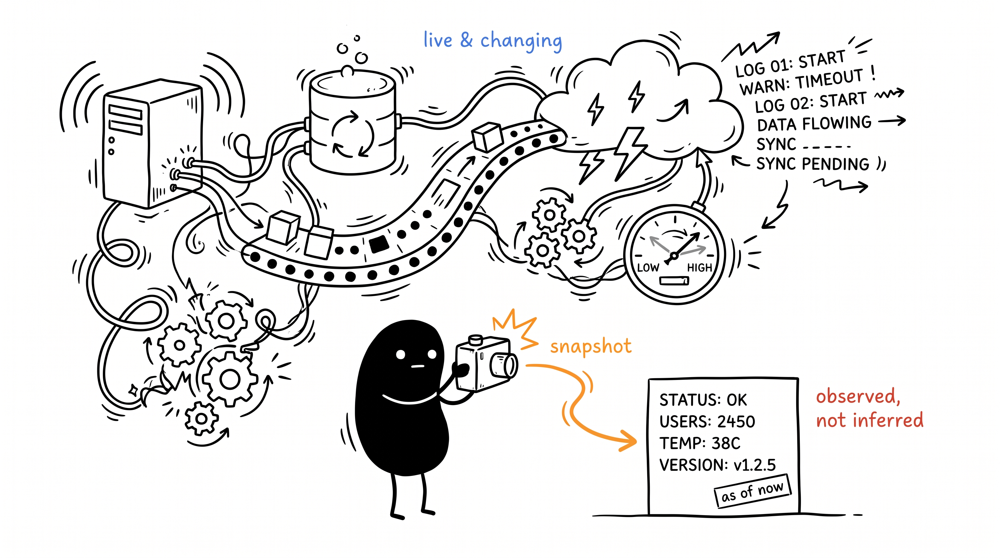
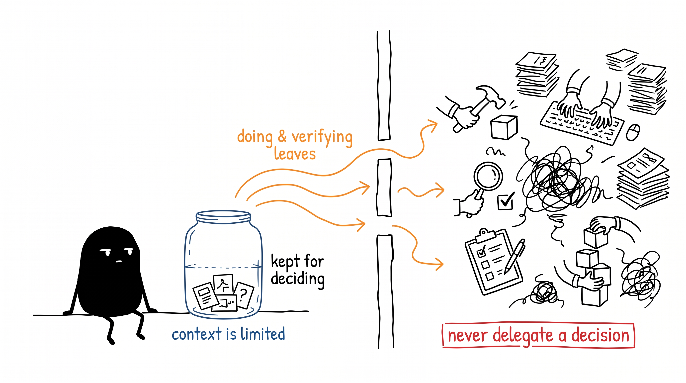

[](https://skills.sh/saadshahd/moo.md)

Why introduce friction? Because **YOU** the human end up being the world model. The agent is just your hands.

**moo/hope** doesn't build, and doesn't author your code, rules, or taste. It works alongside build tooling like [superpowers](https://github.com/obra/superpowers).

One idea runs through every layer: **agents at the pace you think.**

## Installation (30-second setup)

### 1. Get the skills

```bash
curl -fsSL https://saadshahd.github.io/moo.md/install.sh | sh
```

One line works out what your machine has. Run it again to update.

- **Claude Code** gets the `hope`, `hold` and `hunch` [plugins](https://code.claude.com/docs/en/plugins), managed bundles that update when I ship, and the `hold:Plain` output style. A session already open needs `/reload-plugins`.
- **Codex, Cursor, Copilot, Gemini CLI and opencode** get the same skills as files in `~/.agents/skills`, copied by [skills.sh](https://skills.sh/saadshahd/moo.md) and yours to edit.
- **Both on one machine** get both. Claude Code does not read `~/.agents`, so no skill lands twice.

<details>
<summary><strong>Claude Code: what this runs</strong></summary>

```bash
claude plugin install hope --marketplace saadshahd/moo.md --scope user
claude plugin install hold --marketplace saadshahd/moo.md --scope user
claude plugin install hunch --marketplace saadshahd/moo.md --scope user
claude plugin marketplace update moo.md
claude plugin update hope@moo.md
claude plugin update hold@moo.md
claude plugin update hunch@moo.md
```

Then it sets `"outputStyle": "hold:Plain"` in `~/.claude/settings.json` and keeps every other key.

`hope` is the decision loop, and the reason to be here. `hold` is comprehension at your own pace, and its `hold:Plain` output style keeps replies short. `hunch` is experiments that graduate or die. One more layer ships from the same marketplace: `sound@moo.md`, code taste as installable rules.

</details>

<details>
<summary><strong>Codex, Cursor, Copilot, and other agents: what this runs</strong></summary>

When your home folder holds `.codex`, `.cursor`, `.copilot`, `.gemini` or `.config/opencode`:

```bash
npx --yes skills@latest add saadshahd/moo.md/hope --global --agent universal --skill '*' --yes
npx --yes skills@latest add saadshahd/moo.md/hold --global --agent universal --skill '*' --yes
npx --yes skills@latest add saadshahd/moo.md/hunch --global --agent universal --skill '*' --yes
```

`hope` and `hold` arrive whole: their skills call each other by name, and a missing one stops the skill that called it.

They land as ordinary files you own — flat, and without the plugin prefix, so `hope:intent` arrives as `intent` and `hold:grasp` as `grasp`. Watch for collisions with skills you already have. Running the line again replaces them, your edits included.

For an agent that reads its own folder, such as Windsurf or Goose, or to add `sound`, pick the skills and the agents yourself:

```bash
npx skills@latest add saadshahd/moo.md
```

</details>

### 2. Run the loop

```
/hope:full <your seed>
```

Or run the stages directly — `/hope:intent <your seed>`, then `/hope:shape <your intent>`.

## A loop

The loop is pure decision work. You drive it slowly, in your own context.

Every piece of work starts as a raw `<seed>`, the rough thing you fully typed. It is the one artifact that is fully yours.

**/intent** and **/shape** do not make the seed more honest. They make it explicit and specified. Each surfaces a decision as an interactive question, every choice previewed, a few at a time, and you answer. Every added detail stays yours because you chose it. `/intent` turns the `<seed>` into a confirmed statement of what you want. `/shape` turns that `<work order>` into a chosen approach before any code exists.

The outcome is short enough to carry comfortably outside the context window.



## An anchor

**freeze** anchors the work to what is observed, not what you remember. When a stage depends on state that lives outside the repo — a service, a database, a queue, live logs — that state keeps moving, and memory of it goes stale the moment you look away.

freeze snaps the slice your work touches into one immutable value: every fact observed live or named as an open gap, never inferred. The stages decide against a fact, not a guess. It is the ground the other three stand on — and repo-local work skips it.



## A mode

**router** is the line between deciding and doing.

You keep every decision. The session spawns agents and verifies their output, doing no work itself — only tactical, observable work fans out: implement, test, verify, audit, explore.

This is also what stops compaction from silently rewriting your context. The verbose doing never enters your main thread, so it can never quietly mutate what you decided.



## Overview

| The trap                                 | Layer                          | Guard                                        |
| ---------------------------------------- | ------------------------------ | -------------------------------------------- |
| AI fills in your decisions               | `/hope:intent` & `/hope:shape` | interactive questions, each choice previewed |
| compaction mutates & drifts your context | `/hope:router`                 | doing stays out, deciding stays in           |
| stale or remembered external state       | `/hope:freeze`                 | snapshot facts, never infer                  |

## Reading

- [The Engineer's Anxiety at the Penalty Kick](https://saadshahd.github.io/blog/the-engineers-anxiety-at-the-penalty-kick/) — "Ownership without comprehension is just a signature."
- [One Flew Over the Context Window](https://saadshahd.github.io/blog/one-flew-over-the-context-window/) — what the agent never carries between sessions.
